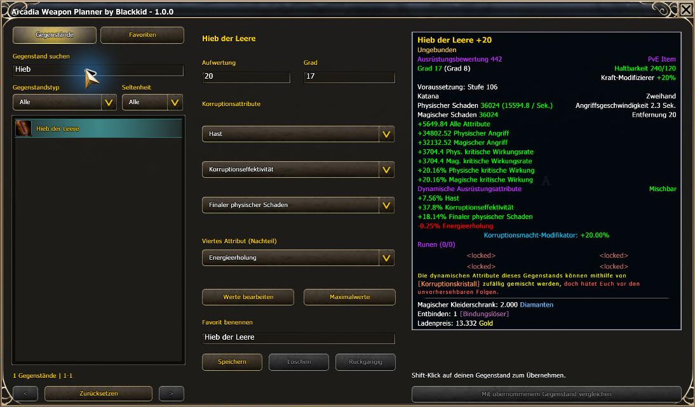

# Arcadia Weapon Planner

**Plan your next item before upgrading it.** A Chronicles of Arcadia addon by **Blackkid**.

Search equipment, preview tier and upgrade levels, choose corruption attributes, save favorites and compare them with your own items using the game's native tooltips.



## Install

1. Download **ArcadiaWeaponPlanner-1.0.0.zip** from [Releases](https://github.com/libsman/ArcadiaWeaponPlanner/releases/latest).
2. Extract the `ArcadiaWeaponPlanner` folder into your game's `Interface/AddOns` directory.
3. Reload the UI or restart the game. Type **`/awp`** to open the planner.

When updating, replace the addon folder. Favorites are stored separately by the game; do not delete your saved settings.

## Use

- **Find an item:** type part of its localized name or its item ID. Combine item-type and rarity filters.
- **Plan an upgrade:** set upgrade and tier, then choose corruption attributes. **Maximum values** restores maximum base rolls while keeping your chosen attributes. **Edit values** reveals optional base-roll inputs.
- **Save a favorite:** enter a name and click **Save**. Saving the same name updates it; a different name creates another variant. **Delete** removes the selected favorite; **Undo** restores the last deletion in the current session.
- **Import your item:** with the planner open, Shift-click a supported item in your equipment window or backpack. Close chat input and auction windows first if they are receiving item links.
- **Compare:** import your item, then edit the configuration or select a favorite and click **Compare with imported item**. The imported reference stays unchanged until you import another item or reload the UI.

The planner never equips, consumes, buys or upgrades an item. Unsaved edits reset on UI reload; favorites use the game's normal saved-variable mechanism and persist across normal reloads/logins.

## What the preview means

The tooltip uses **your current character's modifiers** and assumes **overdurability**. **Personal effectiveness** defaults to **Include**; choose **Ignore** to preview corruption rolls at 100% personal effectiveness. The choice is saved and applies to both comparison sides. Original imports and favorites remain unchanged. The effectiveness roll itself is not amplified by personal effectiveness and therefore stays unchanged. Neutralization reads the native tooltip's two-decimal total, so tiny rounding differences are possible. It does not simulate a complete equipment change or predict total character DPS.

For comparisons of the same item type, both sides use the imported runes and added stats. For different item types, both sides omit them. Imported corruption rolls are preserved exactly, including unfamiliar attribute IDs; the maximum-values action leaves unfamiliar rolls untouched.

The catalogue contains **78 supported items**: 75 Shattered Grove level-106 records and three supported world-boss items (IDs 1210371, 1220155 and 1220156). It is a curated catalogue, not a search of every item in the game.

Base-roll factors: one-handed **1.0**, two-handed **1.5**, instruments **1.35**, and the three world-boss items **0.875**. Instrument factor 1.35 is the planner's configured assumption. Tier, overdurability and character corruption modifiers are applied by the native tooltip, not multiplied into the raw roll a second time.

Stat-range reference: [official Corruption System wiki](https://chroniclesofarcadia.com/en/wiki/equipment/corruption-system). Current haste and final physical-damage attributes are maintained separately from legacy wiki labels. Server patches may require data updates; custom base values remain available.

## Languages

English, German, Spanish, French, Polish, Russian, Turkish, Japanese, Korean, Simplified Chinese and Traditional Chinese. Item and attribute names come from the game. English is the fallback for an unsupported client language.

## Feedback

Please use [GitHub Issues](https://github.com/libsman/ArcadiaWeaponPlanner/issues). Include the addon version, client language, item ID and steps to reproduce. Crop screenshots to the relevant UI and avoid posting private chat or account information.

## Development

The repository's `addon/ArcadiaWeaponPlanner` directory is the distributable addon. Run the Lua 5.1 regression tests with:

```sh
python -m pip install -r requirements-dev.txt
python -m unittest discover -s tests -v
```

Logic tests supplement real-client UI testing. The 1.0.0 release was checked in the German client; other locale files have matching key coverage but are not claimed to have been visually tested in all eleven clients.

## License

Copyright (C) 2026 Blackkid. Licensed under **GPL-3.0-only**; see [LICENSE](LICENSE). Game artwork and native UI assets are referenced from the installed client and are not bundled or relicensed. This is an independent community addon, not an official game product.
